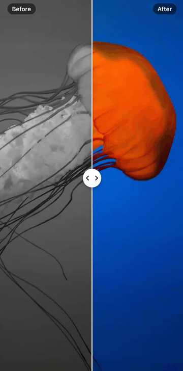

<div align="center">

# react-native-image-comparison

A smooth, customizable before/after slider for React Native.

Compare two images or any two views with a draggable divider. Powered by Reanimated worklets for UI-thread gesture handling and animations.



</div>

## Why this one

- **Smooth UI-thread animations.** The gesture and every frame run on the UI thread with Reanimated worklets, animating transforms only. While you drag, nothing crosses to JS.
- **iOS, Android and Web.** The same component and API on all three.
- **Compare any two React views.** `before` and `after` are plain React nodes: images, videos, maps, whole screens.
- **Customizable handle.** Render your own and animate it in sync with the divider.
- **Horizontal and vertical orientations.** Switch with a single prop.
- **Controlled position with SharedValue.** Drive the divider from code, or read where the user left it.
- **ScrollView gesture compatibility.** Dragging along one axis keeps a parent ScrollView on the other axis scrolling.
- **RTL support.** The handle stays on the divider in right-to-left layouts.
- **No custom native code.** Pure TypeScript on top of Reanimated and Gesture Handler.

## Installation

Works with both Expo and React Native CLI apps on the New Architecture. Expo Go is not supported because it bundles Gesture Handler 2, so use a [development build](https://docs.expo.dev/develop/development-builds/introduction/). On the web it runs through [React Native Web](https://necolas.github.io/react-native-web/). The library itself is pure JS; it needs these peer dependencies:

- `react-native-reanimated` >= 4.1
- `react-native-worklets` >= 0.5
- `react-native-gesture-handler` >= 3.0

First install and set up the peer dependencies by following their official guides:

- [Reanimated](https://docs.swmansion.com/react-native-reanimated/docs/fundamentals/getting-started)
- [Worklets](https://docs.swmansion.com/react-native-worklets/docs/fundamentals/getting-started)
- [Gesture Handler](https://docs.swmansion.com/react-native-gesture-handler/docs/fundamentals/installation)

Then install the library:

```sh
# Expo
npx expo install react-native-image-comparison

# React Native CLI
npm install react-native-image-comparison
```

## Usage

```tsx
import { Image, StyleSheet } from 'react-native';
import { ImageComparison } from 'react-native-image-comparison';

export function Example() {
  return (
    <ImageComparison
      before={<Image source={require('./before.jpg')} style={StyleSheet.absoluteFill} />}
      after={<Image source={require('./after.jpg')} style={StyleSheet.absoluteFill} />}
      style={{ width: '100%', aspectRatio: 4 / 3 }}
    />
  );
}
```

`before` and `after` can be any views and are rendered as is, so give them a size, usually `StyleSheet.absoluteFill`.

### Custom handle

`renderHandle` replaces the default handle and receives the divider position, so the handle can animate with it. This one fades out near the edges:

```tsx
import Animated, { interpolate, useAnimatedStyle, type SharedValue } from 'react-native-reanimated';

function Handle({ position }: { position: SharedValue<number> }) {
  const style = useAnimatedStyle(() => ({
    opacity: interpolate(position.value, [0, 0.1, 0.9, 1], [0, 1, 1, 0]),
  }));

  return <Animated.View style={[{ width: 4, height: '100%', backgroundColor: 'white' }, style]} />;
}

<ImageComparison
  before={before}
  after={after}
  renderHandle={(position) => <Handle position={position} />}
/>;
```

For `orientation="vertical"`, draw a horizontal line instead.

### Controlled position

Pass your own shared value to move the divider from code or read its position:

```tsx
import { Button } from 'react-native';
import { useSharedValue, withTiming } from 'react-native-reanimated';

export function Example() {
  const position = useSharedValue(0.5);

  return (
    <>
      <ImageComparison before={before} after={after} position={position} />
      <Button title="Show after" onPress={() => (position.value = withTiming(0))} />
    </>
  );
}
```

## API

| Prop              | Type                                           | Default        | Description                                                                                    |
| ----------------- | ---------------------------------------------- | -------------- | ---------------------------------------------------------------------------------------------- |
| `before`          | `ReactNode`                                    | required       | Content on the left of the divider, or above it when vertical.                                 |
| `after`           | `ReactNode`                                    | required       | Content on the right of the divider, or below it when vertical.                                |
| `orientation`     | `'horizontal' \| 'vertical'`                   | `'horizontal'` | Direction the divider moves in.                                                                |
| `initialPosition` | `number`                                       | `0.5`          | Starting divider position, from 0 (left or top) to 1 (right or bottom).                        |
| `position`        | `SharedValue<number>`                          |                | Divider position from 0 to 1, to control or read it from outside. Overrides `initialPosition`. |
| `enabled`         | `boolean`                                      | `true`         | Whether the divider can be moved.                                                              |
| `style`           | `StyleProp<ViewStyle>`                         |                | Style of the container.                                                                        |
| `testID`          | `string`                                       |                | Used to locate the component in end-to-end tests.                                              |
| `renderHandle`    | `(position: SharedValue<number>) => ReactNode` |                | Custom handle. Receives the divider position from 0 to 1.                                      |
| `onSlidingStart`  | `(position: number) => void`                   |                | Called when the user starts dragging, with the divider position.                               |
| `onSlidingEnd`    | `(position: number) => void`                   |                | Called when the user stops dragging, with the divider position.                                |

## License

MIT
